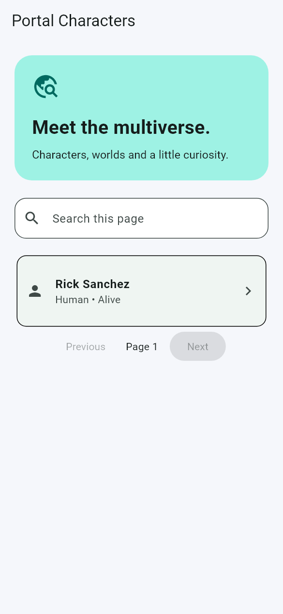

# Portal Characters

## Description

Portal Characters is a Flutter app for exploring characters from the Rick and Morty API. Users can browse pages of characters, search the currently displayed page and open character details. The app uses Dio for requests and Cubit to manage loading, success and error states.

## Preview



Sample mobile screen with offline test data.

## Features

- Load character data from the Rick and Morty REST API.
- Browse multiple pages of character results.
- Search characters by name within the current page.
- Open a character details screen.
- Display loading and error states with a retry action.
- Organize data access through a service, repository and Cubit.

## Built with

Flutter, Dart, Material 3, Dio and flutter_bloc. Service → repository → Cubit → screens.

The code uses straightforward widgets and small methods so it is easy to follow and extend. The existing Dart package name remains `project1`.

## Run locally

Use Flutter 3.47.5 / Dart 3.13.4 or a compatible newer SDK.

```bash
git clone https://github.com/YOUR_USERNAME/portal-characters.git
cd portal-characters
flutter pub get
flutter run
```

Run `flutter pub get` after changing Flutter versions to regenerate local package metadata. Choose a connected Android device, iOS simulator on macOS, or another supported target with `flutter devices`.

## Checks

```bash
flutter analyze
flutter test
```

## Project structure

- `lib/main.dart`: app entry point.
- `lib/ui.dart`: theme and introductory card.
- `lib/`: screens and small project-specific components.
- `test/`: smoke and behavior tests.
- `android/`, `ios/`, `web/`: platform scaffolding where generated.

## Limitations

- An internet connection is required; there is no offline cache.
- Search only filters the current page, not the complete API catalog.
- Data availability depends on the public API.
- There are no user accounts or saved favorites.
- The README preview uses offline sample data for screenshot capture.
- Native device behavior and signed release builds have not been verified.

API documentation: [Rick and Morty API](https://rickandmortyapi.com/documentation/).

## Validation

Checked locally with Flutter 3.47.5 / Dart 3.13.4: analysis and tests pass. Mobile previews were captured with Flutter widget rendering. Native device behavior and signed release builds have not been verified.

A small GitHub Actions workflow runs formatting, analysis and tests on pushes and pull requests. It will run after this repository is uploaded.

## License and assets

No open-source license has been selected. Existing bundled artwork is retained; verify your right to redistribute it before choosing a license. Character artwork and data, where applicable, belong to their respective owners.
